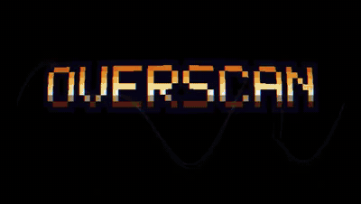

# Overscan

> Audiovisual effects in your terminal, written in TypeScript. Open the same scene in the browser when you want a bigger canvas—not the other way around.

Every effect with an animated preview: **[docs/EXAMPLES.md](docs/EXAMPLES.md)**; every option of every effect: **[docs/EFFECTS.md](docs/EFFECTS.md)**.

JSON node graphs in TypeScript: frames to the terminal (sixel, ANSI half-blocks, ASCII), **Overscan Studio** in the browser when you want it. **Inspired by** demoscene culture, not a stand-in for it—familiar tooling for people who liked that look. **No assembly required** (every sense).

## Try it

[](docs/media/showcase.mp4)

*Highlights of the showcase demo. Click for the full 97 seconds with sound ([MP4](docs/media/showcase.mp4)).*

You need Node 20+ and pnpm 9+. From the repository root:

```bash
pnpm install && pnpm build
pnpm run overscan -- run examples/showcase.demo.json
```

That plays the showcase in your terminal: twelve scenes cut to a synthesised soundtrack. **←/→** jump between scenes, **Space** pauses, **↑/↓** double or halve the speed, **Esc** quits. A bigger terminal window (or a smaller font) gives a sharper picture.

### Sound

The terminal player plays the soundtrack through [mpv](https://mpv.io). Without it the demo still runs, just silent.

- **macOS:** `brew install mpv` (with [Homebrew](https://brew.sh))
- **Windows:** `scoop bucket add extras` then `scoop install mpv` (with [Scoop](https://scoop.sh)), or `winget install --id shinchiro.mpv -e`. Open a new terminal afterwards and check that `mpv --version` works.
- **Linux:** your package manager's `mpv`, for example `sudo apt install mpv`.

### In the browser

```bash
pnpm run overscan -- dev examples/showcase.demo.json
```

This opens **Overscan Studio** at http://localhost:4242: the same demo with its node graphs, timeline, keyframes and soundtrack, all editable. Run `run` and `dev` side by side to watch the terminal and the canvas together.

Every other effect has its own example scene, listed with previews in [docs/EXAMPLES.md](docs/EXAMPLES.md). Play any of them the same way, for example `pnpm run overscan -- run examples/generators/plasma.scene.json`.

## What it looks like

**ANSI** uses half-block characters for colour; **sixel** is nearer to pixels where the terminal allows; **ASCII** uses shaded glyphs (truecolour when available). **Terminal first:** `overscan run` in one pane, `overscan dev` on the same file in another for low-res glow next to Studio or a canvas.

Scenes are JSON: nodes, edges, and an output pointing at what feeds the terminal (or export). Minimal shape:

```json
{
  "id": "hello",
  "duration": 30,
  "resolution": { "width": 640, "height": 360 },
  "fps": 30,
  "tracks": [],
  "graph": {
    "nodes": [
      { "id": "p", "type": "generator", "impl": "plasma", "config": { "speed": 1 } }
    ],
    "edges": [],
    "outputs": { "terminal": "p" }
  }
}
```

Numbers can be literals, timeline keys (Rocket-style), or signal-node outputs—one file stays authoritative. Generators draw, modifiers transform one buffer, compositors merge, signals feed numbers; the same graph runs in the terminal, browser, and export.

## Packages


| Package                   | Role                                                            |
| ------------------------- | --------------------------------------------------------------- |
| `@overscan/types`         | Shared TypeScript types                                         |
| `@overscan/core`          | Graph execution, buffers, timeline, scene loading               |
| `@overscan/nodes`         | Generators, modifiers, compositors, signals                     |
| `@overscan/sink-terminal` | Sixel, ANSI, ASCII output                                       |
| `@overscan/sink-browser`  | Browser / WebGL sinks                                           |
| `@overscan/sink-export`   | PNG sequences, MP4/GIF, terminal raster export                  |
| `@overscan/cli`           | `overscan` command (`run`, `dev`, `export`, `validate`, `init`) |
| `@overscan/sequencer`     | Multi-section demo types                                        |
| `@overscan/text`          | Shared text helpers for text-oriented nodes                     |
| `@overscan/studio`        | Browser Studio (preview, editing, timeline UI)                  |


## License

MIT