# Examples gallery

<!-- Generated by scripts/build-examples-doc.mjs. Do not edit by hand: `pnpm build && pnpm export-example-gifs && pnpm build-examples-doc`. -->

Every built-in effect (61 in total) has an example scene, shown here as the terminal draws it (ANSI half-blocks on an 80×24 grid) and at full resolution. Option tables for each effect are in [EFFECTS.md](EFFECTS.md).

Play any example in the terminal with `pnpm run overscan -- run <scene>`, or open it in the studio with `pnpm run overscan -- dev <scene>`.

## Contents

- [Showcase demo](#showcase-demo)
- [Generators](#generators) (32): [checkerboard-floor](#checkerboard-floor-checkerboard-floor), [copperbars](#copper-bars-copperbars), [dot-matrix](#dot-matrix-dot-matrix), [dot-tunnel](#dot-tunnel-dot-tunnel), [fire](#fire-fire), [fractal-zoom](#fractal-zoom-fractal-zoom), [game-of-life](#game-of-life-game-of-life), [glenz](#glenz-vectors-glenz), [image](#image--logo-image), [kefrens](#kefrens-bars-kefrens), [lasers](#lasers-lasers), [lissajous](#lissajous-lissajous), [matrix-rain](#matrix-rain-matrix-rain), [metaballs](#metaballs-metaballs), [moire](#moir-moire), [oscilloscope](#oscilloscope-oscilloscope), [particles](#particles-particles), [plasma](#plasma-plasma), [polygon](#polygon-object-polygon), [raymarcher](#raymarcher-raymarcher), [rotozoom](#rotozoom-rotozoom), [scroller](#scroller-scroller), [shadebobs](#shadebobs-shadebobs), [sinebobs](#sinebobs-sinebobs), [starfield](#starfield-starfield), [text](#text-text), [tunnel](#tunnel-tunnel), [twister](#twister-twister), [vector-balls](#vector-balls-vector-balls), [voxel-landscape](#voxel-landscape-voxel-landscape), [water-ripple](#water-ripple-water-ripple), [wireframe](#wireframe-wireframe)
- [Modifiers](#modifiers) (19): [ansi-art](#ansi-art-ansi-art), [blur](#blur-blur), [blur-glow](#blur--glow-blur-glow), [bump](#bump-map-bump), [chromatic-aberration](#chromatic-aberration-chromatic-aberration), [color-grade](#color-grade-color-grade), [crt](#crt-crt), [dither](#dither-dither), [emboss](#emboss-emboss), [feedback](#feedback-feedback), [glow](#glow-glow), [lens](#lens-lens), [mirror](#mirror-mirror), [palette-cycle](#palette-cycle-palette-cycle), [palette-flash](#palette-flash-palette-flash), [pixelate](#pixelate-pixelate), [radial-blur](#radial-blur-radial-blur), [uv-map](#uv-map-uv-map), [wobble](#wobble-wobble)
- [Compositors](#compositors) (7): [additive-blend](#additive-blend-additive-blend), [alpha-blend](#alpha-blend-alpha-blend), [difference-blend](#difference-blend-difference-blend), [multiply-blend](#multiply-blend-multiply-blend), [overlay-blend](#overlay-blend-overlay-blend), [screen-blend](#screen-blend-screen-blend), [transition](#transition-transition)
- [Signals](#signals) (3): [audio-analyser](#audio-analyser-audio-analyser), [lfo](#lfo-lfo), [noise](#noise-noise)
- [Advanced compositions](#advanced-compositions) (17)

## Showcase demo

[`examples/showcase.demo.json`](../examples/showcase.demo.json): **Overscan: pixels bleeding beyond the edge**, 12 sections cut to a synthesised soundtrack (`./showcase/music.mp3`, built by `scripts/build-showcase-music.mjs`). Play it with `pnpm run overscan -- run examples/showcase.demo.json` (audio needs `mpv`) or open it in the studio.

| # | Section | Effects | Into the next |
| ---: | --- | --- | --- |
| 1 | [lock](../examples/showcase/01-lock.scene.json) | `image`, `wobble`, `chromatic-aberration`, `text`, `additive-blend` | — |
| 2 | [bleed](../examples/showcase/02-bleed.scene.json) | `image`, `text`, `additive-blend`, `radial-blur`, `feedback`, `color-grade` | flash 0.25 s |
| 3 | [grid](../examples/showcase/03-grid.scene.json) | `checkerboard-floor`, `polygon`, `alpha-blend`, `chromatic-aberration` | push 0.35 s |
| 4 | [walls](../examples/showcase/04-walls.scene.json) | `kefrens`, `palette-flash` | checker 0.45 s |
| 5 | [flower](../examples/showcase/05-flower.scene.json) | `plasma`, `uv-map` | blinds 0.45 s |
| 6 | [jelly](../examples/showcase/06-jelly.scene.json) | `copperbars`, `polygon`, `alpha-blend`, `dither` | melt 0.9 s |
| 7 | [planet](../examples/showcase/07-planet.scene.json) | `starfield`, `plasma`, `uv-map`, `alpha-blend`, `scroller`, `radial-blur` | flash 0.25 s |
| 8 | [hyperspace](../examples/showcase/08-hyperspace.scene.json) | `dot-tunnel`, `radial-blur` | zoom-out 0.5 s |
| 9 | [monument](../examples/showcase/09-monument.scene.json) | `raymarcher`, `color-grade`, `radial-blur` | push 0.35 s |
| 10 | [burn](../examples/showcase/10-burn.scene.json) | `image`, `fire`, `additive-blend`, `particles`, `wobble` | checker 0.4 s |
| 11 | [finale](../examples/showcase/11-finale.scene.json) | `plasma`, `uv-map`, `polygon`, `particles`, `additive-blend`, `feedback`, `alpha-blend` | melt 1 s |
| 12 | [afterglow](../examples/showcase/12-afterglow.scene.json) | `particles`, `image`, `alpha-blend`, `text`, `additive-blend`, `palette-flash` | — |

Demo-wide modifiers: `crt`.

## Generators

Draw an image from nothing.

### Checkerboard Floor (`checkerboard-floor`)

Flat checkerboard plane in true perspective below a horizon, with scrolling, camera yaw and distance fog.

| Terminal (ANSI, 80×24) | Full resolution |
| :---: | :---: |
| 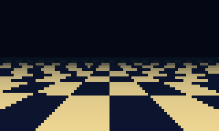 | 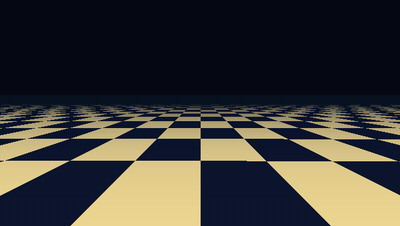 |

[`examples/generators/checkerboard-floor.scene.json`](../examples/generators/checkerboard-floor.scene.json) · `pnpm run overscan -- run examples/generators/checkerboard-floor.scene.json` · [options](EFFECTS.md#checkerboard-floor)

### Copper Bars (`copperbars`)

Amiga-style horizontal copper bars, each shaded dark to bright to dark, swinging on sine paths with near bars drawn over far ones.

| Terminal (ANSI, 80×24) | Full resolution |
| :---: | :---: |
| 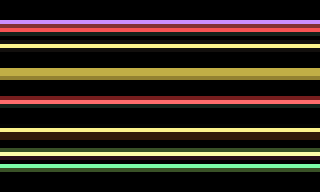 | 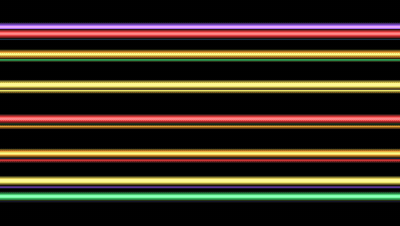 |

[`examples/generators/copperbars.scene.json`](../examples/generators/copperbars.scene.json) · `pnpm run overscan -- run examples/generators/copperbars.scene.json` · [options](EFFECTS.md#copperbars)

#### DYCP Scroller

| Terminal (ANSI, 80×24) | Full resolution |
| :---: | :---: |
| 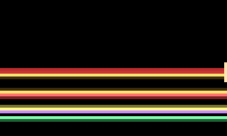 | 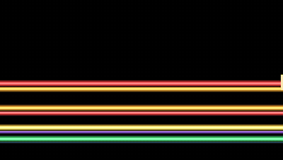 |

[`examples/generators/dycp-scroller.scene.json`](../examples/generators/dycp-scroller.scene.json) · `pnpm run overscan -- run examples/generators/dycp-scroller.scene.json`

### Dot Matrix (`dot-matrix`)

A rotating 3D point cloud (sphere, torus, helix, cube or text) drawn as glowing dots, with optional morphing between two shapes.

| Terminal (ANSI, 80×24) | Full resolution |
| :---: | :---: |
| 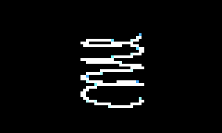 | 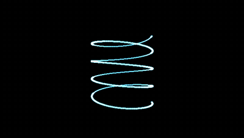 |

[`examples/generators/dot-matrix.scene.json`](../examples/generators/dot-matrix.scene.json) · `pnpm run overscan -- run examples/generators/dot-matrix.scene.json` · [options](EFFECTS.md#dot-matrix)

### Dot Tunnel (`dot-tunnel`)

Rings of dots rushing towards the viewer along a curving path; with flower above 0 the rings bulge into a dot flower.

| Terminal (ANSI, 80×24) | Full resolution |
| :---: | :---: |
| 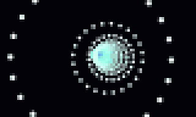 | 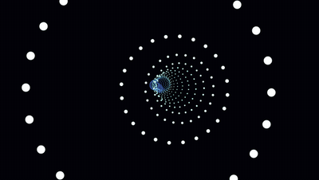 |

[`examples/generators/dot-tunnel.scene.json`](../examples/generators/dot-tunnel.scene.json) · `pnpm run overscan -- run examples/generators/dot-tunnel.scene.json` · [options](EFFECTS.md#dot-tunnel)

#### Dot Flower

| Terminal (ANSI, 80×24) | Full resolution |
| :---: | :---: |
| 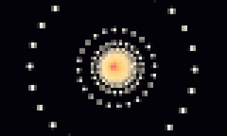 | 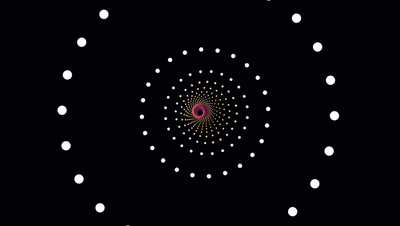 |

[`examples/generators/dot-flower.scene.json`](../examples/generators/dot-flower.scene.json) · `pnpm run overscan -- run examples/generators/dot-flower.scene.json`

### Fire (`fire`)

Classic demoscene fire: heat is seeded along the bottom row, rises, spreads and cools, and is mapped through a palette.

| Terminal (ANSI, 80×24) | Full resolution |
| :---: | :---: |
| 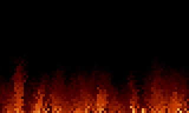 | 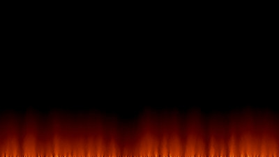 |

[`examples/generators/fire.scene.json`](../examples/generators/fire.scene.json) · `pnpm run overscan -- run examples/generators/fire.scene.json` · [options](EFFECTS.md#fire)

### Fractal Zoom (`fractal-zoom`)

Mandelbrot or Julia set rendered with a cycling palette, with continuous exponential zoom.

| Terminal (ANSI, 80×24) | Full resolution |
| :---: | :---: |
| 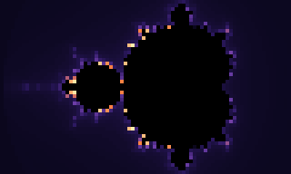 | 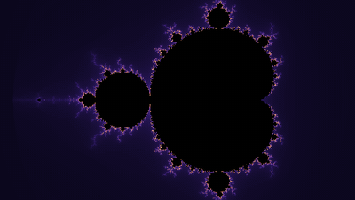 |

[`examples/generators/fractal-zoom.scene.json`](../examples/generators/fractal-zoom.scene.json) · `pnpm run overscan -- run examples/generators/fractal-zoom.scene.json` · [options](EFFECTS.md#fractal-zoom)

### Game of Life (`game-of-life`)

Conway's Game of Life on a cell grid, coloured as plain on/off, by cell age, or through an age palette.

| Terminal (ANSI, 80×24) | Full resolution |
| :---: | :---: |
| 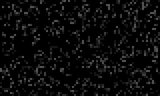 | 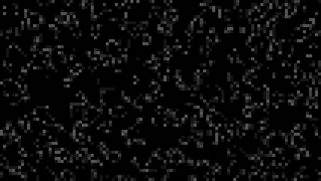 |

[`examples/generators/game-of-life.scene.json`](../examples/generators/game-of-life.scene.json) · `pnpm run overscan -- run examples/generators/game-of-life.scene.json` · [options](EFFECTS.md#game-of-life)

### Glenz Vectors (`glenz`)

Translucent faceted glenz object (a cube with a pyramid on each face) whose back faces show through the front ones.

| Terminal (ANSI, 80×24) | Full resolution |
| :---: | :---: |
| 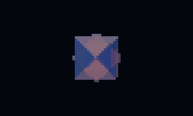 | 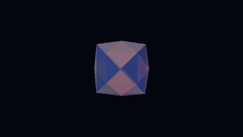 |

[`examples/generators/glenz.scene.json`](../examples/generators/glenz.scene.json) · `pnpm run overscan -- run examples/generators/glenz.scene.json` · [options](EFFECTS.md#glenz)

### Image / Logo (`image`)

Shows a picture, or a gradient-filled text logo in a bitmap font, scaled and placed anywhere; transparent around it.

| Terminal (ANSI, 80×24) | Full resolution |
| :---: | :---: |
| 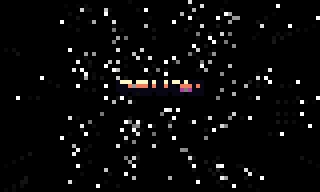 | 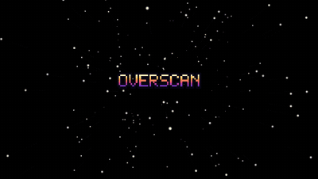 |

[`examples/generators/image.scene.json`](../examples/generators/image.scene.json) · `pnpm run overscan -- run examples/generators/image.scene.json` · [options](EFFECTS.md#image)

### Kefrens Bars (`kefrens`)

One shaded bar drawn on every scanline into a line that is never cleared, so its swing piles up into twisting walls.

| Terminal (ANSI, 80×24) | Full resolution |
| :---: | :---: |
| 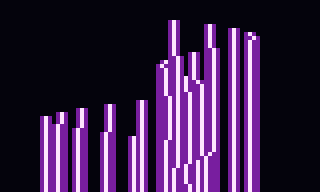 | 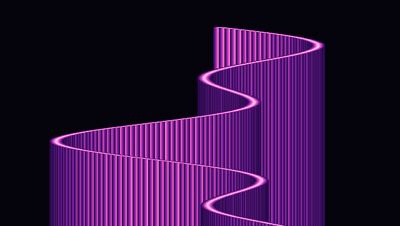 |

[`examples/generators/kefrens.scene.json`](../examples/generators/kefrens.scene.json) · `pnpm run overscan -- run examples/generators/kefrens.scene.json` · [options](EFFECTS.md#kefrens)

### Lasers (`lasers`)

Club-style laser show: fans of glowing beams sweep and rotate from emitters along the bottom, pulsing with the audio.

| Terminal (ANSI, 80×24) | Full resolution |
| :---: | :---: |
| 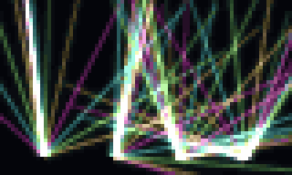 | 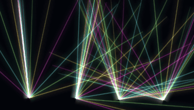 |

[`examples/generators/lasers.scene.json`](../examples/generators/lasers.scene.json) · `pnpm run overscan -- run examples/generators/lasers.scene.json` · [options](EFFECTS.md#lasers)

### Lissajous (`lissajous`)

An oscilloscope-style Lissajous curve traced as a glowing line with a fading phosphor trail.

| Terminal (ANSI, 80×24) | Full resolution |
| :---: | :---: |
| 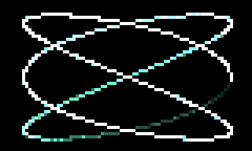 | 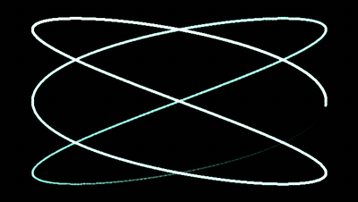 |

[`examples/generators/lissajous.scene.json`](../examples/generators/lissajous.scene.json) · `pnpm run overscan -- run examples/generators/lissajous.scene.json` · [options](EFFECTS.md#lissajous)

### Matrix Rain (`matrix-rain`)

Falling columns of glyphs with bright heads and fading trails, in the style of The Matrix.

| Terminal (ANSI, 80×24) | Full resolution |
| :---: | :---: |
| 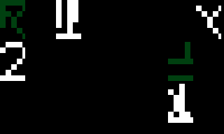 | 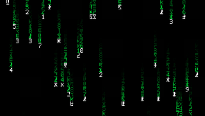 |

[`examples/generators/matrix-rain.scene.json`](../examples/generators/matrix-rain.scene.json) · `pnpm run overscan -- run examples/generators/matrix-rain.scene.json` · [options](EFFECTS.md#matrix-rain)

### Metaballs (`metaballs`)

Blobby metaballs moving on sine paths that merge where their fields overlap, coloured through a palette.

| Terminal (ANSI, 80×24) | Full resolution |
| :---: | :---: |
| 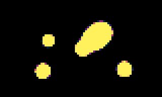 | 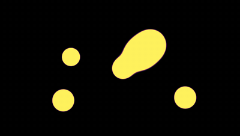 |

[`examples/generators/metaballs.scene.json`](../examples/generators/metaballs.scene.json) · `pnpm run overscan -- run examples/generators/metaballs.scene.json` · [options](EFFECTS.md#metaballs)

### Moiré (`moire`)

Two overlapping line, ring or radial patterns whose interference makes shifting moiré fringes.

| Terminal (ANSI, 80×24) | Full resolution |
| :---: | :---: |
| 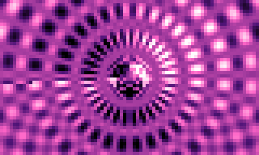 | 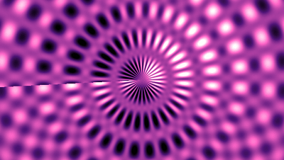 |

[`examples/generators/moire.scene.json`](../examples/generators/moire.scene.json) · `pnpm run overscan -- run examples/generators/moire.scene.json` · [options](EFFECTS.md#moire)

### Oscilloscope (`oscilloscope`)

A glowing oscilloscope trace of a synthetic waveform over a graticule, with optional phosphor persistence.

| Terminal (ANSI, 80×24) | Full resolution |
| :---: | :---: |
| 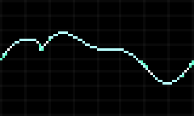 | 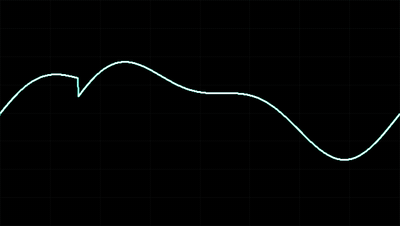 |

[`examples/generators/oscilloscope.scene.json`](../examples/generators/oscilloscope.scene.json) · `pnpm run overscan -- run examples/generators/oscilloscope.scene.json` · [options](EFFECTS.md#oscilloscope)

### Particles (`particles`)

Particle systems computed from time alone (exact when seeking): fountain, explosions, vortex, or a strange-attractor cloud.

| Terminal (ANSI, 80×24) | Full resolution |
| :---: | :---: |
| 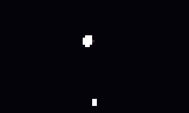 | 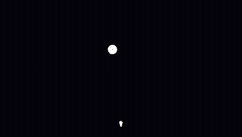 |

[`examples/generators/particles.scene.json`](../examples/generators/particles.scene.json) · `pnpm run overscan -- run examples/generators/particles.scene.json` · [options](EFFECTS.md#particles)

#### Strange Attractor

| Terminal (ANSI, 80×24) | Full resolution |
| :---: | :---: |
| 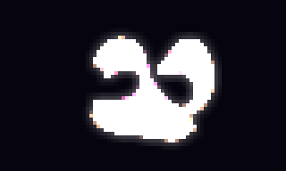 | 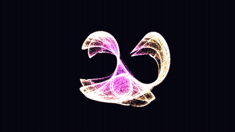 |

[`examples/generators/strange-attractor.scene.json`](../examples/generators/strange-attractor.scene.json) · `pnpm run overscan -- run examples/generators/strange-attractor.scene.json`

### Plasma (`plasma`)

Classic sum-of-sines plasma mapped through a cycling colour palette.

| Terminal (ANSI, 80×24) | Full resolution |
| :---: | :---: |
| 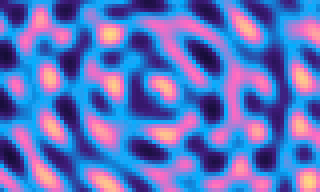 | 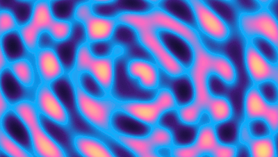 |

[`examples/generators/plasma.scene.json`](../examples/generators/plasma.scene.json) · `pnpm run overscan -- run examples/generators/plasma.scene.json` · [options](EFFECTS.md#plasma)

### Polygon Object (`polygon`)

Solid 3D objects with a depth buffer: flat, Gouraud or chrome (environment-mapped) shading, and an optional rubber (jelly) wobble.

| Terminal (ANSI, 80×24) | Full resolution |
| :---: | :---: |
| 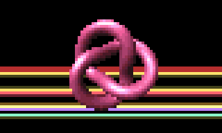 | 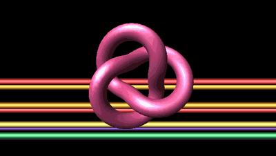 |

[`examples/generators/polygon.scene.json`](../examples/generators/polygon.scene.json) · `pnpm run overscan -- run examples/generators/polygon.scene.json` · [options](EFFECTS.md#polygon)

#### Environment-mapped torus

| Terminal (ANSI, 80×24) | Full resolution |
| :---: | :---: |
| 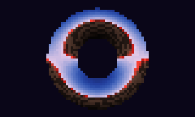 | 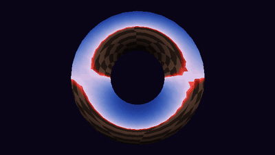 |

[`examples/generators/chrome-torus.scene.json`](../examples/generators/chrome-torus.scene.json) · `pnpm run overscan -- run examples/generators/chrome-torus.scene.json`

#### Rubber Vector

| Terminal (ANSI, 80×24) | Full resolution |
| :---: | :---: |
| 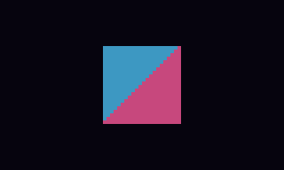 | 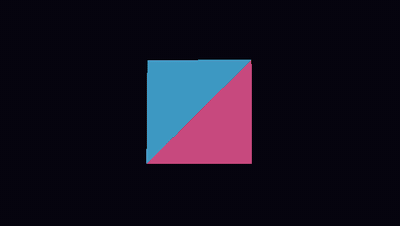 |

[`examples/generators/rubber-vector.scene.json`](../examples/generators/rubber-vector.scene.json) · `pnpm run overscan -- run examples/generators/rubber-vector.scene.json`

### Raymarcher (`raymarcher`)

Sphere-traces a signed-distance scene written in GLSL, lit by a single directional light with distance fog.

| Terminal (ANSI, 80×24) | Full resolution |
| :---: | :---: |
| 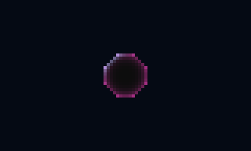 | 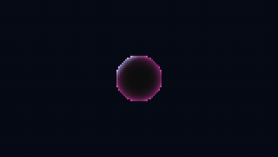 |

[`examples/generators/raymarcher.scene.json`](../examples/generators/raymarcher.scene.json) · `pnpm run overscan -- run examples/generators/raymarcher.scene.json` · [options](EFFECTS.md#raymarcher)

#### Raymarcher Monument

| Terminal (ANSI, 80×24) | Full resolution |
| :---: | :---: |
|  |  |

[`examples/generators/raymarcher-monument.scene.json`](../examples/generators/raymarcher-monument.scene.json) · `pnpm run overscan -- run examples/generators/raymarcher-monument.scene.json`

### Rotozoom (`rotozoom`)

A tiled texture rotated and zoomed around a centre point, the classic rotozoomer.

| Terminal (ANSI, 80×24) | Full resolution |
| :---: | :---: |
|  |  |

[`examples/generators/rotozoom.scene.json`](../examples/generators/rotozoom.scene.json) · `pnpm run overscan -- run examples/generators/rotozoom.scene.json` · [options](EFFECTS.md#rotozoom)

### Scroller (`scroller`)

A bitmap-font text line scrolling across the screen on a sine wave, in per-column or per-character (DYCP) style.

| Terminal (ANSI, 80×24) | Full resolution |
| :---: | :---: |
|  |  |

[`examples/generators/scroller.scene.json`](../examples/generators/scroller.scene.json) · `pnpm run overscan -- run examples/generators/scroller.scene.json` · [options](EFFECTS.md#scroller)

### Shadebobs (`shadebobs`)

Flat bobs stamped along Lissajous paths that add to a wrapping colour index, building contour bands.

| Terminal (ANSI, 80×24) | Full resolution |
| :---: | :---: |
|  |  |

[`examples/generators/shadebobs.scene.json`](../examples/generators/shadebobs.scene.json) · `pnpm run overscan -- run examples/generators/shadebobs.scene.json` · [options](EFFECTS.md#shadebobs)

### Sinebobs (`sinebobs`)

Glowing sprites following a chain of Lissajous paths, with optional motion trails.

| Terminal (ANSI, 80×24) | Full resolution |
| :---: | :---: |
|  |  |

[`examples/generators/sinebobs.scene.json`](../examples/generators/sinebobs.scene.json) · `pnpm run overscan -- run examples/generators/sinebobs.scene.json` · [options](EFFECTS.md#sinebobs)

### Starfield (`starfield`)

Stars flying out from a vanishing point, growing as they approach.

| Terminal (ANSI, 80×24) | Full resolution |
| :---: | :---: |
|  |  |

[`examples/generators/starfield.scene.json`](../examples/generators/starfield.scene.json) · `pnpm run overscan -- run examples/generators/starfield.scene.json` · [options](EFFECTS.md#starfield)

### Text (`text`)

Static bitmap-font text, single or multi-line, placed anywhere on screen.

| Terminal (ANSI, 80×24) | Full resolution |
| :---: | :---: |
|  |  |

[`examples/generators/text.scene.json`](../examples/generators/text.scene.json) · `pnpm run overscan -- run examples/generators/text.scene.json` · [options](EFFECTS.md#text)

### Tunnel (`tunnel`)

A textured tunnel flown through by mapping screen angle and depth onto a texture.

| Terminal (ANSI, 80×24) | Full resolution |
| :---: | :---: |
|  |  |

[`examples/generators/tunnel.scene.json`](../examples/generators/tunnel.scene.json) · `pnpm run overscan -- run examples/generators/tunnel.scene.json` · [options](EFFECTS.md#tunnel)

### Twister (`twister`)

Classic twister bar: a square column whose rotation varies down the screen, with shaded faces.

| Terminal (ANSI, 80×24) | Full resolution |
| :---: | :---: |
|  |  |

[`examples/generators/twister.scene.json`](../examples/generators/twister.scene.json) · `pnpm run overscan -- run examples/generators/twister.scene.json` · [options](EFFECTS.md#twister)

### Vector Balls (`vector-balls`)

Shaded balls on the vertices and edges of a rotating 3D object that morphs between shapes.

| Terminal (ANSI, 80×24) | Full resolution |
| :---: | :---: |
|  |  |

[`examples/generators/vector-balls.scene.json`](../examples/generators/vector-balls.scene.json) · `pnpm run overscan -- run examples/generators/vector-balls.scene.json` · [options](EFFECTS.md#vector-balls)

### Voxel Landscape (`voxel-landscape`)

Comanche-style voxel terrain flown over, from a heightmap image or procedural noise.

| Terminal (ANSI, 80×24) | Full resolution |
| :---: | :---: |
|  |  |

[`examples/generators/voxel-landscape.scene.json`](../examples/generators/voxel-landscape.scene.json) · `pnpm run overscan -- run examples/generators/voxel-landscape.scene.json` · [options](EFFECTS.md#voxel-landscape)

### Water Ripple (`water-ripple`)

A height-field water simulation whose ripples refract a texture or pool-tile pattern.

| Terminal (ANSI, 80×24) | Full resolution |
| :---: | :---: |
|  |  |

[`examples/generators/water-ripple.scene.json`](../examples/generators/water-ripple.scene.json) · `pnpm run overscan -- run examples/generators/water-ripple.scene.json` · [options](EFFECTS.md#water-ripple)

### Wireframe (`wireframe`)

A rotating wireframe cube drawn with perspective lines.

| Terminal (ANSI, 80×24) | Full resolution |
| :---: | :---: |
|  |  |

[`examples/generators/wireframe.scene.json`](../examples/generators/wireframe.scene.json) · `pnpm run overscan -- run examples/generators/wireframe.scene.json` · [options](EFFECTS.md#wireframe)

## Modifiers

Change the image fed into them.

### ANSI Art (`ansi-art`)

Redraws the input as a grid of text-mode cells (blocks, ASCII glyphs or braille dots) coloured by the average of each cell.

| Terminal (ANSI, 80×24) | Full resolution |
| :---: | :---: |
|  |  |

[`examples/modifiers/ansi-art.scene.json`](../examples/modifiers/ansi-art.scene.json) · `pnpm run overscan -- run examples/modifiers/ansi-art.scene.json` · [options](EFFECTS.md#ansi-art)

### Blur (`blur`)

Box blur of the input; a preset of Blur / Glow in blur mode.

| Terminal (ANSI, 80×24) | Full resolution |
| :---: | :---: |
|  |  |

[`examples/modifiers/blur.scene.json`](../examples/modifiers/blur.scene.json) · `pnpm run overscan -- run examples/modifiers/blur.scene.json` · [options](EFFECTS.md#blur)

### Blur / Glow (`blur-glow`)

Box blur that either replaces the input (blur) or is added back on top of it (glow).

| Terminal (ANSI, 80×24) | Full resolution |
| :---: | :---: |
|  |  |

[`examples/modifiers/blur-glow.scene.json`](../examples/modifiers/blur-glow.scene.json) · `pnpm run overscan -- run examples/modifiers/blur-glow.scene.json` · [options](EFFECTS.md#blur-glow)

### Bump Map (`bump`)

Treats the input’s brightness as a height map (a logo works well) and lights it with a moving point light.

| Terminal (ANSI, 80×24) | Full resolution |
| :---: | :---: |
|  |  |

[`examples/modifiers/bump.scene.json`](../examples/modifiers/bump.scene.json) · `pnpm run overscan -- run examples/modifiers/bump.scene.json` · [options](EFFECTS.md#bump)

### Chromatic Aberration (`chromatic-aberration`)

Shifts the red and blue channels in opposite directions to fake lens colour fringing.

| Terminal (ANSI, 80×24) | Full resolution |
| :---: | :---: |
|  |  |

[`examples/modifiers/chromatic-aberration.scene.json`](../examples/modifiers/chromatic-aberration.scene.json) · `pnpm run overscan -- run examples/modifiers/chromatic-aberration.scene.json` · [options](EFFECTS.md#chromatic-aberration)

### Color Grade (`color-grade`)

Remaps the input through a luminance gradient palette or per-channel curves, blended with the original.

| Terminal (ANSI, 80×24) | Full resolution |
| :---: | :---: |
|  |  |

[`examples/modifiers/color-grade.scene.json`](../examples/modifiers/color-grade.scene.json) · `pnpm run overscan -- run examples/modifiers/color-grade.scene.json` · [options](EFFECTS.md#color-grade)

### CRT (`crt`)

Cathode-ray tube look: scanlines, barrel distortion, vignette, phosphor glow and an optional RGB shadow mask.

| Terminal (ANSI, 80×24) | Full resolution |
| :---: | :---: |
|  |  |

[`examples/modifiers/crt.scene.json`](../examples/modifiers/crt.scene.json) · `pnpm run overscan -- run examples/modifiers/crt.scene.json` · [options](EFFECTS.md#crt)

### Dither (`dither`)

Ordered (Bayer) dithering to a fixed palette (C64, CGA, EGA, Game Boy, PICO-8…) or a few levels per channel.

| Terminal (ANSI, 80×24) | Full resolution |
| :---: | :---: |
|  |  |

[`examples/modifiers/dither.scene.json`](../examples/modifiers/dither.scene.json) · `pnpm run overscan -- run examples/modifiers/dither.scene.json` · [options](EFFECTS.md#dither)

### Emboss (`emboss`)

Relief shading from the brightness difference along a light direction, in grey or tinted by the original colour.

| Terminal (ANSI, 80×24) | Full resolution |
| :---: | :---: |
|  |  |

[`examples/modifiers/emboss.scene.json`](../examples/modifiers/emboss.scene.json) · `pnpm run overscan -- run examples/modifiers/emboss.scene.json` · [options](EFFECTS.md#emboss)

### Feedback (`feedback`)

Blends each frame with a shifted, scaled copy of the previous output to leave trails and tunnels.

| Terminal (ANSI, 80×24) | Full resolution |
| :---: | :---: |
|  |  |

[`examples/modifiers/feedback.scene.json`](../examples/modifiers/feedback.scene.json) · `pnpm run overscan -- run examples/modifiers/feedback.scene.json` · [options](EFFECTS.md#feedback)

### Glow (`glow`)

Adds a blurred copy of the input on top of itself; a preset of Blur / Glow in glow mode.

| Terminal (ANSI, 80×24) | Full resolution |
| :---: | :---: |
|  |  |

[`examples/modifiers/glow.scene.json`](../examples/modifiers/glow.scene.json) · `pnpm run overscan -- run examples/modifiers/glow.scene.json` · [options](EFFECTS.md#glow)

### Lens (`lens`)

Magnifying-glass bulge inside a circular area, with optional colour fringing.

| Terminal (ANSI, 80×24) | Full resolution |
| :---: | :---: |
|  |  |

[`examples/modifiers/lens.scene.json`](../examples/modifiers/lens.scene.json) · `pnpm run overscan -- run examples/modifiers/lens.scene.json` · [options](EFFECTS.md#lens)

### Mirror (`mirror`)

Reflects the image around an origin point, horizontally, vertically, into four quadrants or eight kaleidoscope slices.

| Terminal (ANSI, 80×24) | Full resolution |
| :---: | :---: |
|  |  |

[`examples/modifiers/mirror.scene.json`](../examples/modifiers/mirror.scene.json) · `pnpm run overscan -- run examples/modifiers/mirror.scene.json` · [options](EFFECTS.md#mirror)

### Palette Cycle (`palette-cycle`)

Maps pixel brightness through a palette whose offset rotates over time, like classic colour cycling.

| Terminal (ANSI, 80×24) | Full resolution |
| :---: | :---: |
|  |  |

[`examples/modifiers/palette-cycle.scene.json`](../examples/modifiers/palette-cycle.scene.json) · `pnpm run overscan -- run examples/modifiers/palette-cycle.scene.json` · [options](EFFECTS.md#palette-cycle)

### Palette Flash (`palette-flash`)

Flashes the image towards a solid colour, typically driven by a beat or track.

| Terminal (ANSI, 80×24) | Full resolution |
| :---: | :---: |
|  |  |

[`examples/modifiers/palette-flash.scene.json`](../examples/modifiers/palette-flash.scene.json) · `pnpm run overscan -- run examples/modifiers/palette-flash.scene.json` · [options](EFFECTS.md#palette-flash)

### Pixelate (`pixelate`)

Reduces the image to large blocks, drawn as squares, circles or diamonds.

| Terminal (ANSI, 80×24) | Full resolution |
| :---: | :---: |
|  |  |

[`examples/modifiers/pixelate.scene.json`](../examples/modifiers/pixelate.scene.json) · `pnpm run overscan -- run examples/modifiers/pixelate.scene.json` · [options](EFFECTS.md#pixelate)

### Radial Blur (`radial-blur`)

Zoom streaks out from a centre point; in rays mode only bright parts streak, added on top as light rays.

| Terminal (ANSI, 80×24) | Full resolution |
| :---: | :---: |
|  |  |

[`examples/modifiers/radial-blur.scene.json`](../examples/modifiers/radial-blur.scene.json) · `pnpm run overscan -- run examples/modifiers/radial-blur.scene.json` · [options](EFFECTS.md#radial-blur)

### UV Map (`uv-map`)

Maps the input onto a tunnel, flower tunnel or sphere, or twirls it around the centre, by per-pixel texture coordinates.

| Terminal (ANSI, 80×24) | Full resolution |
| :---: | :---: |
|  |  |

[`examples/modifiers/uv-map.scene.json`](../examples/modifiers/uv-map.scene.json) · `pnpm run overscan -- run examples/modifiers/uv-map.scene.json` · [options](EFFECTS.md#uv-map)

#### Sphere mapping

| Terminal (ANSI, 80×24) | Full resolution |
| :---: | :---: |
|  |  |

[`examples/modifiers/sphere-mapping.scene.json`](../examples/modifiers/sphere-mapping.scene.json) · `pnpm run overscan -- run examples/modifiers/sphere-mapping.scene.json`

#### Twirl

| Terminal (ANSI, 80×24) | Full resolution |
| :---: | :---: |
|  |  |

[`examples/modifiers/twirl.scene.json`](../examples/modifiers/twirl.scene.json) · `pnpm run overscan -- run examples/modifiers/twirl.scene.json`

### Wobble (`wobble`)

Raster wobble: shifts each scanline (or column) of the input by a sine, the classic wobbling logo.

| Terminal (ANSI, 80×24) | Full resolution |
| :---: | :---: |
|  |  |

[`examples/modifiers/wobble.scene.json`](../examples/modifiers/wobble.scene.json) · `pnpm run overscan -- run examples/modifiers/wobble.scene.json` · [options](EFFECTS.md#wobble)

## Compositors

Combine two or more images.

### Additive Blend (`additive-blend`)

Adds the overlay onto the base, optionally masked by the luminance of a mask input.

| Terminal (ANSI, 80×24) | Full resolution |
| :---: | :---: |
|  |  |

[`examples/compositors/additive-blend.scene.json`](../examples/compositors/additive-blend.scene.json) · `pnpm run overscan -- run examples/compositors/additive-blend.scene.json` · [options](EFFECTS.md#additive-blend)

### Alpha Blend (`alpha-blend`)

Standard "over" compositing of the overlay onto the base using its alpha, optionally masked.

| Terminal (ANSI, 80×24) | Full resolution |
| :---: | :---: |
|  |  |

[`examples/compositors/alpha-blend.scene.json`](../examples/compositors/alpha-blend.scene.json) · `pnpm run overscan -- run examples/compositors/alpha-blend.scene.json` · [options](EFFECTS.md#alpha-blend)

### Difference Blend (`difference-blend`)

Absolute difference of base and overlay, optionally masked.

| Terminal (ANSI, 80×24) | Full resolution |
| :---: | :---: |
|  |  |

[`examples/compositors/difference-blend.scene.json`](../examples/compositors/difference-blend.scene.json) · `pnpm run overscan -- run examples/compositors/difference-blend.scene.json` · [options](EFFECTS.md#difference-blend)

### Multiply Blend (`multiply-blend`)

Multiplies base by overlay, darkening it, optionally masked.

| Terminal (ANSI, 80×24) | Full resolution |
| :---: | :---: |
|  |  |

[`examples/compositors/multiply-blend.scene.json`](../examples/compositors/multiply-blend.scene.json) · `pnpm run overscan -- run examples/compositors/multiply-blend.scene.json` · [options](EFFECTS.md#multiply-blend)

### Overlay Blend (`overlay-blend`)

Overlay blend: multiplies the base darks and screens its lights with the overlay, optionally masked.

| Terminal (ANSI, 80×24) | Full resolution |
| :---: | :---: |
|  |  |

[`examples/compositors/overlay-blend.scene.json`](../examples/compositors/overlay-blend.scene.json) · `pnpm run overscan -- run examples/compositors/overlay-blend.scene.json` · [options](EFFECTS.md#overlay-blend)

### Screen Blend (`screen-blend`)

Screen blend that brightens the base with the overlay, optionally masked.

| Terminal (ANSI, 80×24) | Full resolution |
| :---: | :---: |
|  |  |

[`examples/compositors/screen-blend.scene.json`](../examples/compositors/screen-blend.scene.json) · `pnpm run overscan -- run examples/compositors/screen-blend.scene.json` · [options](EFFECTS.md#screen-blend)

### Transition (`transition`)

Transitions from base to overlay with a dissolve, wipe, zoom, iris or flash, driven by a progress value.

| Terminal (ANSI, 80×24) | Full resolution |
| :---: | :---: |
|  |  |

[`examples/compositors/transition.scene.json`](../examples/compositors/transition.scene.json) · `pnpm run overscan -- run examples/compositors/transition.scene.json` · [options](EFFECTS.md#transition)

## Signals

Produce numbers that drive other nodes’ settings.

### Audio Analyser (`audio-analyser`)

Analyses a WAV file in sync with the timeline and outputs loudness, brightness, beat, zero-crossing, chroma and MFCC-style bands.

| Terminal (ANSI, 80×24) | Full resolution |
| :---: | :---: |
|  |  |

[`examples/signals/audio-analyser.scene.json`](../examples/signals/audio-analyser.scene.json) · `pnpm run overscan -- run examples/signals/audio-analyser.scene.json` · [options](EFFECTS.md#audio-analyser)

### LFO (`lfo`)

Low-frequency oscillator producing a periodic wave (or stepped random values) plus its phase.

| Terminal (ANSI, 80×24) | Full resolution |
| :---: | :---: |
|  |  |

[`examples/signals/lfo.scene.json`](../examples/signals/lfo.scene.json) · `pnpm run overscan -- run examples/signals/lfo.scene.json` · [options](EFFECTS.md#lfo)

### Noise (`noise`)

Smoothed random signal that picks a new target value at a fixed rate.

| Terminal (ANSI, 80×24) | Full resolution |
| :---: | :---: |
|  |  |

[`examples/signals/noise.scene.json`](../examples/signals/noise.scene.json) · `pnpm run overscan -- run examples/signals/noise.scene.json` · [options](EFFECTS.md#noise)

## Advanced compositions

Several effects wired together; the chain lists each scene’s nodes in graph order.

### Blur Glow Stack

Nodes: `metaballs` · `text` · `screen-blend` · `blur-glow` · `glow` · `crt`

| Terminal (ANSI, 80×24) | Full resolution |
| :---: | :---: |
|  |  |

[`examples/advanced/blur-glow-stack.scene.json`](../examples/advanced/blur-glow-stack.scene.json) · `pnpm run overscan -- run examples/advanced/blur-glow-stack.scene.json`

### Cells Matrix Scope

Nodes: `game-of-life` · `matrix-rain` · `oscilloscope` · `screen-blend` · `additive-blend` · `color-grade` · `crt`

| Terminal (ANSI, 80×24) | Full resolution |
| :---: | :---: |
|  |  |

[`examples/advanced/cells-matrix-scope.scene.json`](../examples/advanced/cells-matrix-scope.scene.json) · `pnpm run overscan -- run examples/advanced/cells-matrix-scope.scene.json`

### Copper Sinebobs

Nodes: `copperbars` · `sinebobs` · `screen-blend`

| Terminal (ANSI, 80×24) | Full resolution |
| :---: | :---: |
|  |  |

[`examples/advanced/copper-sinebobs.scene.json`](../examples/advanced/copper-sinebobs.scene.json) · `pnpm run overscan -- run examples/advanced/copper-sinebobs.scene.json`

### Fire Scroller

Nodes: `fire` · `scroller` · `additive-blend`

| Terminal (ANSI, 80×24) | Full resolution |
| :---: | :---: |
|  |  |

[`examples/advanced/fire-scroller.scene.json`](../examples/advanced/fire-scroller.scene.json) · `pnpm run overscan -- run examples/advanced/fire-scroller.scene.json`

### Floor Metaballs

Nodes: `checkerboard-floor` · `metaballs` · `screen-blend` · `glow` · `crt`

| Terminal (ANSI, 80×24) | Full resolution |
| :---: | :---: |
|  |  |

[`examples/advanced/floor-metaballs.scene.json`](../examples/advanced/floor-metaballs.scene.json) · `pnpm run overscan -- run examples/advanced/floor-metaballs.scene.json`

### Fractal Floor

Nodes: `fractal-zoom` · `checkerboard-floor` · `overlay-blend` · `lens` · `crt`

| Terminal (ANSI, 80×24) | Full resolution |
| :---: | :---: |
|  |  |

[`examples/advanced/fractal-floor.scene.json`](../examples/advanced/fractal-floor.scene.json) · `pnpm run overscan -- run examples/advanced/fractal-floor.scene.json`

### Moire Mirror Cycle

Nodes: `moire` · `mirror` · `palette-cycle`

| Terminal (ANSI, 80×24) | Full resolution |
| :---: | :---: |
|  |  |

[`examples/advanced/moire-mirror-cycle.scene.json`](../examples/advanced/moire-mirror-cycle.scene.json) · `pnpm run overscan -- run examples/advanced/moire-mirror-cycle.scene.json`

### Neon Layers

Nodes: `plasma` · `tunnel` · `lasers` · `screen-blend` · `additive-blend` · `chromatic-aberration` · `glow` · `crt`

| Terminal (ANSI, 80×24) | Full resolution |
| :---: | :---: |
|  |  |

[`examples/advanced/neon-layers.scene.json`](../examples/advanced/neon-layers.scene.json) · `pnpm run overscan -- run examples/advanced/neon-layers.scene.json`

### Plasma under a lens

Nodes: `plasma` · `lens`

| Terminal (ANSI, 80×24) | Full resolution |
| :---: | :---: |
|  |  |

[`examples/advanced/plasma-lens.scene.json`](../examples/advanced/plasma-lens.scene.json) · `pnpm run overscan -- run examples/advanced/plasma-lens.scene.json`

### Raymarcher Metaballs

Nodes: `raymarcher` · `metaballs` · `screen-blend` · `color-grade`

| Terminal (ANSI, 80×24) | Full resolution |
| :---: | :---: |
|  |  |

[`examples/advanced/raymarcher-metaballs.scene.json`](../examples/advanced/raymarcher-metaballs.scene.json) · `pnpm run overscan -- run examples/advanced/raymarcher-metaballs.scene.json`

### Scroller ASCII

Nodes: `starfield` · `scroller` · `alpha-blend` · `palette-flash` · `ansi-art`

| Terminal (ANSI, 80×24) | Full resolution |
| :---: | :---: |
|  |  |

[`examples/advanced/scroller-ascii.scene.json`](../examples/advanced/scroller-ascii.scene.json) · `pnpm run overscan -- run examples/advanced/scroller-ascii.scene.json`

### Text Title

Nodes: `plasma` · `text` · `screen-blend` · `feedback` · `glow` · `crt`

| Terminal (ANSI, 80×24) | Full resolution |
| :---: | :---: |
|  |  |

[`examples/advanced/text-title.scene.json`](../examples/advanced/text-title.scene.json) · `pnpm run overscan -- run examples/advanced/text-title.scene.json`

### Transition Playground

Nodes: `plasma` · `lissajous` · `transition`

| Terminal (ANSI, 80×24) | Full resolution |
| :---: | :---: |
|  |  |

[`examples/advanced/transition-playground.scene.json`](../examples/advanced/transition-playground.scene.json) · `pnpm run overscan -- run examples/advanced/transition-playground.scene.json`

### Tunnel Roto Stack

Nodes: `tunnel` · `rotozoom` · `overlay-blend`

| Terminal (ANSI, 80×24) | Full resolution |
| :---: | :---: |
|  |  |

[`examples/advanced/tunnel-roto-stack.scene.json`](../examples/advanced/tunnel-roto-stack.scene.json) · `pnpm run overscan -- run examples/advanced/tunnel-roto-stack.scene.json`

### Vector Balls Show

Nodes: `starfield` · `vector-balls` · `screen-blend` · `glow` · `crt`

| Terminal (ANSI, 80×24) | Full resolution |
| :---: | :---: |
|  |  |

[`examples/advanced/vectorballs-show.scene.json`](../examples/advanced/vectorballs-show.scene.json) · `pnpm run overscan -- run examples/advanced/vectorballs-show.scene.json`

### Voxel Cruise

Nodes: `starfield` · `voxel-landscape` · `additive-blend` · `feedback` · `crt`

| Terminal (ANSI, 80×24) | Full resolution |
| :---: | :---: |
|  |  |

[`examples/advanced/voxel-cruise.scene.json`](../examples/advanced/voxel-cruise.scene.json) · `pnpm run overscan -- run examples/advanced/voxel-cruise.scene.json`

### Water Dot

Nodes: `water-ripple` · `dot-matrix` · `screen-blend` · `mirror` · `crt`

| Terminal (ANSI, 80×24) | Full resolution |
| :---: | :---: |
|  |  |

[`examples/advanced/water-dot.scene.json`](../examples/advanced/water-dot.scene.json) · `pnpm run overscan -- run examples/advanced/water-dot.scene.json`

## See also

- [Effects reference](EFFECTS.md): every option of every effect
- [Scene format](scene-format.md)
- [Graph model](graph-model.md)
