# Examples gallery

Single-scene **generators** live under [`examples/generators/`](../examples/generators/); **advanced** multi-node graphs under [`examples/advanced/`](../examples/advanced/). Each section matches a `*.scene.json` basename.

**Animated GIF previews** are stored under `docs/examples/` (next to this file):

- `docs/examples/generators/{name}-terminal.gif` — terminal raster export (80×24, ANSI half-block)
- `docs/examples/generators/{name}-ascii.gif` — ASCII raster at **160×48** character cells (2× the ANSI grid), then **scaled to 640×384** to match the ANSI GIF (`export-example-gifs` uses Lanczos + palette)
- `docs/examples/generators/{name}-webgl.gif` — headless WebGL blit + palette GIF

The same pattern applies in `docs/examples/advanced/`.

**Image paths in this document are relative to `docs/EXAMPLES.md`** (e.g. `examples/generators/plasma-terminal.gif`, `…-ascii.gif`, `…-webgl.gif`). They render in GitHub, VS Code Markdown Preview, and most static site generators **after** you generate the files:

```bash
pnpm build
pnpm export-example-gifs
```

Full option tables for every `impl` are in [`EFFECTS.md`](EFFECTS.md). JSON blocks below are **this repo’s example `config`** only.

---

## Contents

- [Generator examples](#generator-examples)
- [Advanced compositions](#advanced-compositions)
- [See also](#see-also)

---

## Generator examples

| Impl | Description |
| --- | --- |
| `checkerboard-floor` | Perspective checker ground, sky, fog, scroll |
| `copperbars` | Horizontal colour bars (Amiga-style copper) |
| `dot-matrix` | Point grids / paths (e.g. helix) |
| `fire` | 2D heat simulation (stateful) |
| `fractal-zoom` | Mandelbrot / Julia zoom |
| `game-of-life` | Cellular automaton on a grid |
| `glenz` | Stacked transparent shaded shapes |
| `lasers` | Beams from emitters, sweep and glow |
| `lissajous` | Parametric curves, trail, glow |
| `matrix-rain` | Falling glyph columns |
| `metaballs` | 2D metaball field |
| `moire` | Interference patterns |
| `oscilloscope` | Faux scope trace + grid |
| `plasma` | Summed waves + palette |
| `raymarcher` | SDF ray marching (inline or `scenePath` GLSL) |
| `rotozoom` | Rotate + zoom texture |
| `scroller` | Horizontal text + sine warp |
| `shadebobs` | Shaded blobs + palette |
| `sinebobs` | Circles on sine paths |
| `starfield` | 3D star motion |
| `text` | Positioned text + font |
| `tunnel` | Cylindrical tunnel |
| `twister` | Vertical sine “twister” bars |
| `vector-balls` | 3D balls (defaults in node) |
| `voxel-landscape` | Heightfield voxels |
| `water-ripple` | Ripple sim + refraction look |
| `wireframe` | 3D wire mesh |

### Checkerboard Floor

**Scene:** [`examples/generators/checkerboard-floor.scene.json`](../examples/generators/checkerboard-floor.scene.json)

```json
{
  "color1": "#ffe59b",
  "color2": "#0c1430",
  "fogColor": "#08111f",
  "skyColor": "#050814",
  "horizon": 0.42,
  "scrollSpeed": 0.2,
  "rotationSpeed": 0.12
}
```

| ANSI (80×24) | ASCII (160×48 downscaled) | WebGL |
| :---: | :---: | :---: |
| 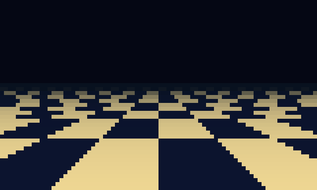 | 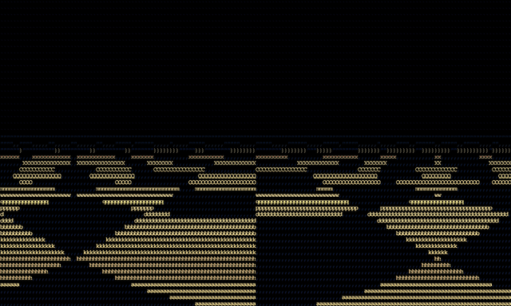 | 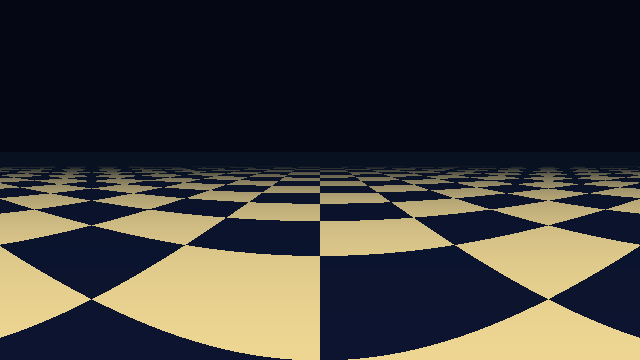 |

### Copperbars

**Scene:** [`examples/generators/copperbars.scene.json`](../examples/generators/copperbars.scene.json)

```json
{ "speed": 1.2, "count": 18 }
```

| ANSI (80×24) | ASCII (160×48 downscaled) | WebGL |
| :---: | :---: | :---: |
| 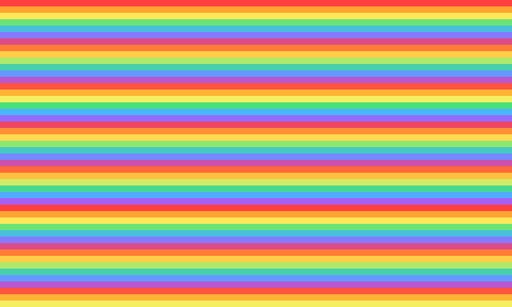 | 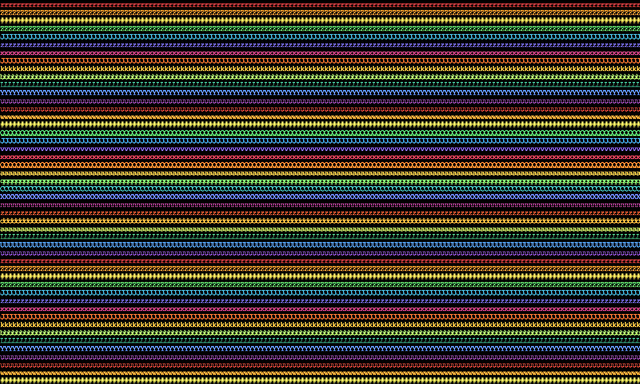 | 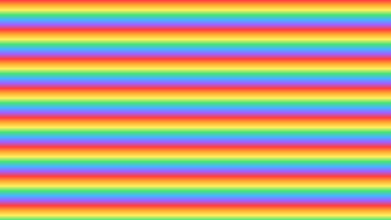 |

### Dot Matrix

**Scene:** [`examples/generators/dot-matrix.scene.json`](../examples/generators/dot-matrix.scene.json)

```json
{ "shape": "helix", "count": 1800, "pointSize": 2.5 }
```

| ANSI (80×24) | ASCII (160×48 downscaled) | WebGL |
| :---: | :---: | :---: |
| 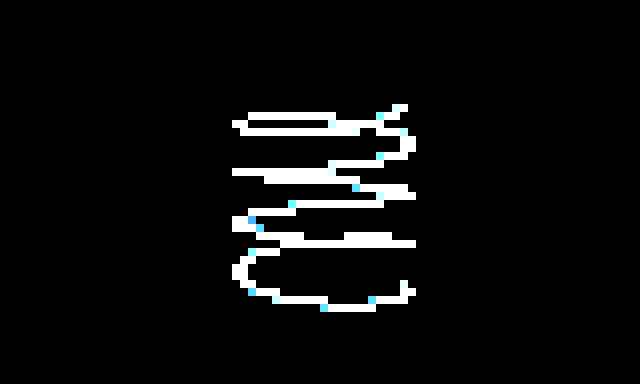 | 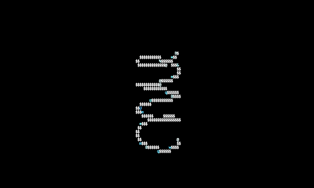 | 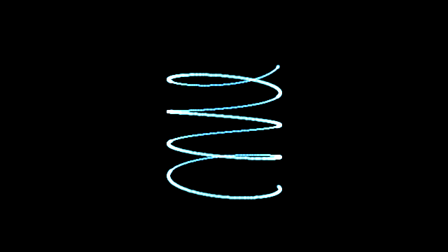 |

### Fire

**Scene:** [`examples/generators/fire.scene.json`](../examples/generators/fire.scene.json)

```json
{ "cooling": 0.09, "seed": "noise", "seedIntensity": 1.1 }
```

| ANSI (80×24) | ASCII (160×48 downscaled) | WebGL |
| :---: | :---: | :---: |
| 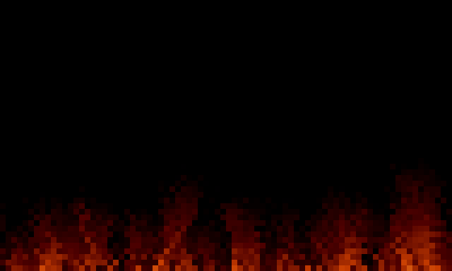 | 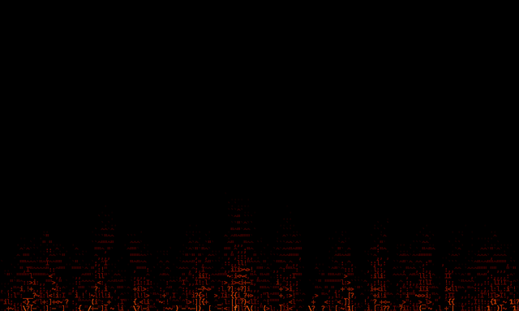 | 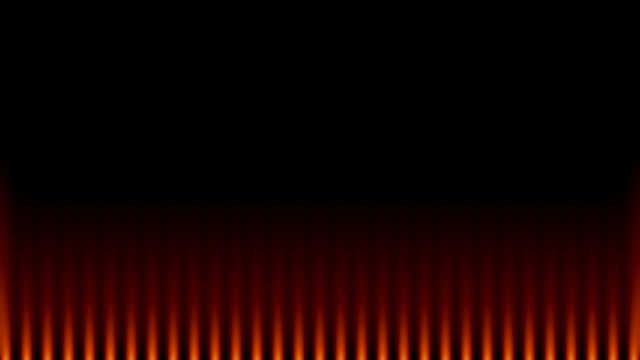 |

### Fractal Zoom

**Scene:** [`examples/generators/fractal-zoom.scene.json`](../examples/generators/fractal-zoom.scene.json)

```json
{
  "type": "mandelbrot",
  "zoom": 1.1,
  "zoomSpeed": 0.06,
  "maxIter": 80,
  "smooth": true
}
```

| ANSI (80×24) | ASCII (160×48 downscaled) | WebGL |
| :---: | :---: | :---: |
| 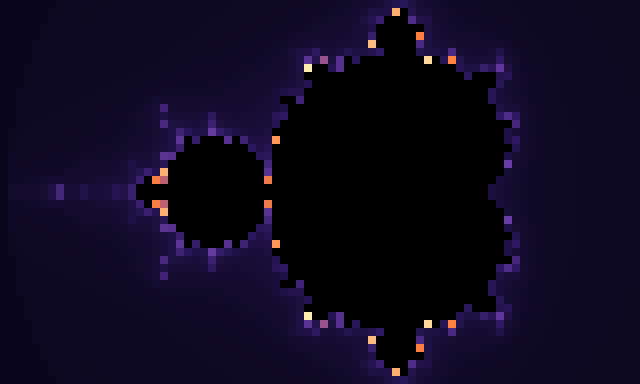 | 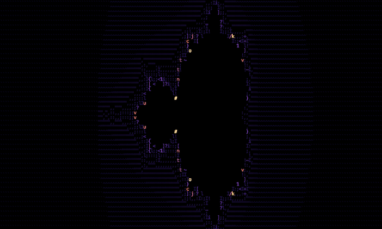 | 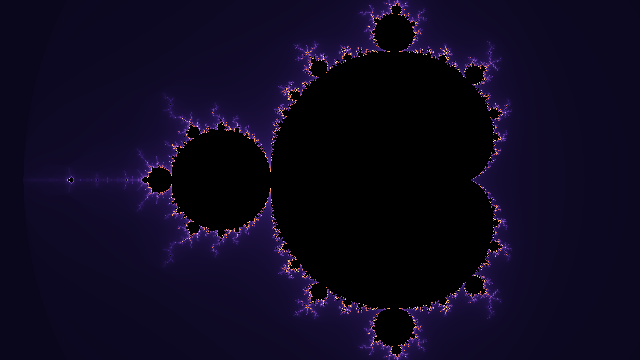 |

### Game of Life

**Scene:** [`examples/generators/game-of-life.scene.json`](../examples/generators/game-of-life.scene.json)

```json
{
  "seed": "random",
  "seedDensity": 0.28,
  "scale": 4,
  "speed": 2,
  "colorMode": "age",
  "agePalette": [[8, 10, 18], [0, 180, 100], [255, 255, 255]]
}
```

| ANSI (80×24) | ASCII (160×48 downscaled) | WebGL |
| :---: | :---: | :---: |
| 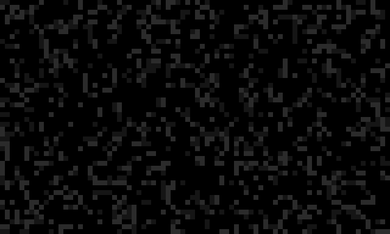 | 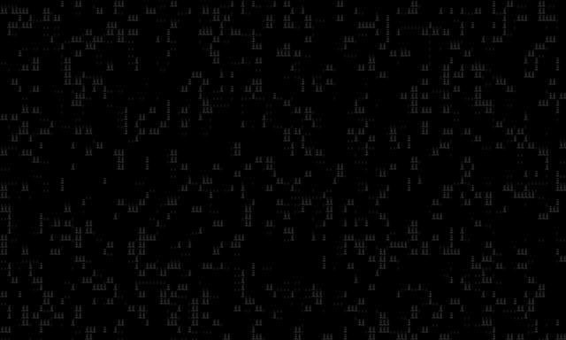 | 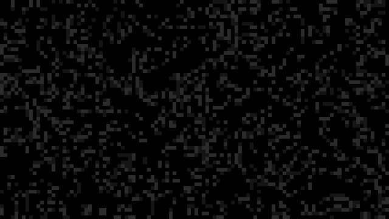 |

### Glenz

**Scene:** [`examples/generators/glenz.scene.json`](../examples/generators/glenz.scene.json)

```json
{ "backgroundColor": "#04060e", "alpha": 0.36 }
```

| ANSI (80×24) | ASCII (160×48 downscaled) | WebGL |
| :---: | :---: | :---: |
| 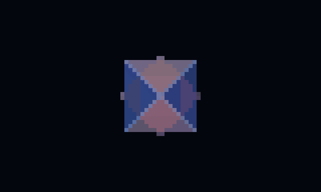 | 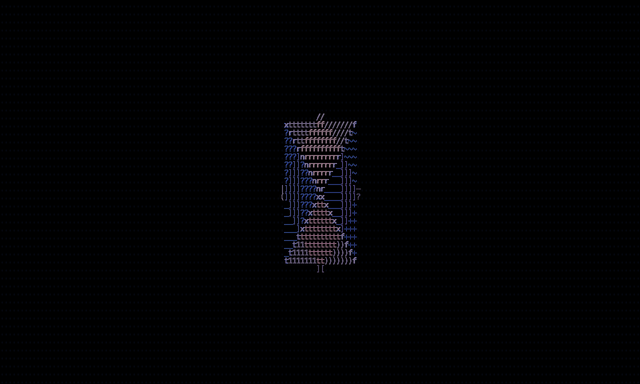 | 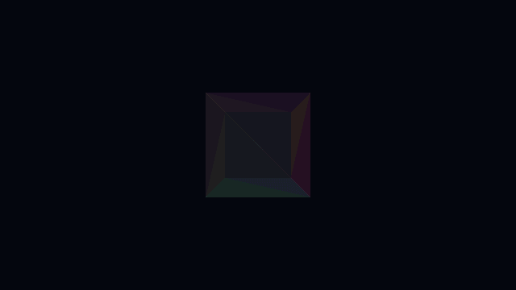 |

### Lasers

**Scene:** [`examples/generators/lasers.scene.json`](../examples/generators/lasers.scene.json)

```json
{
  "beamCount": 20,
  "emitterCount": 4,
  "spread": 1.8,
  "sweepSpeed": 1.1,
  "rotationSpeed": 0.55,
  "beamWidth": 2.4,
  "glowWidth": 20,
  "backgroundColor": "#020409"
}
```

| ANSI (80×24) | ASCII (160×48 downscaled) | WebGL |
| :---: | :---: | :---: |
| 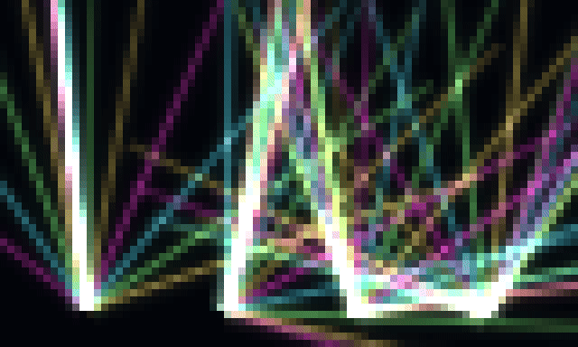 | 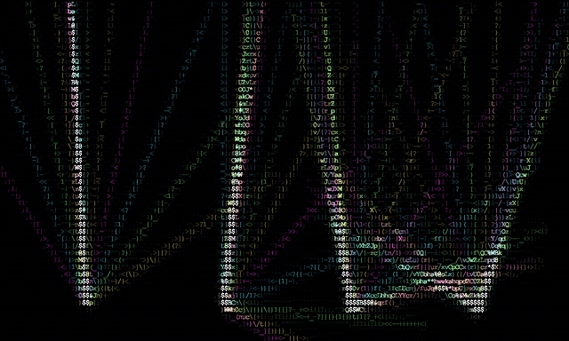 | 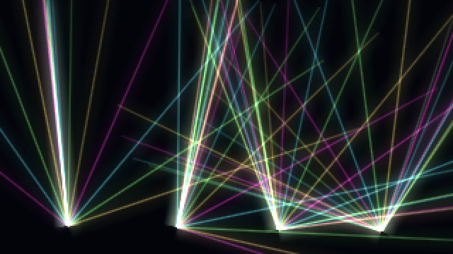 |

### Lissajous

**Scene:** [`examples/generators/lissajous.scene.json`](../examples/generators/lissajous.scene.json)

```json
{
  "a": 3,
  "b": 2,
  "delta": 1.57,
  "amplitude": 0.82,
  "trailLength": 680,
  "decay": 0.95,
  "color": "#68ffca",
  "lineWidth": 1.5,
  "glow": 0.5
}
```

| ANSI (80×24) | ASCII (160×48 downscaled) | WebGL |
| :---: | :---: | :---: |
| 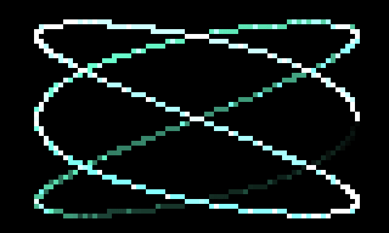 | 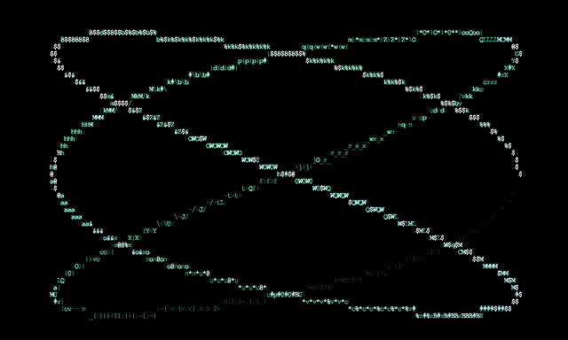 | 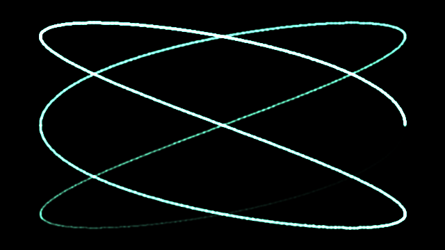 |

### Matrix Rain

**Scene:** [`examples/generators/matrix-rain.scene.json`](../examples/generators/matrix-rain.scene.json)

```json
{
  "charset": "katakana",
  "speed": 1,
  "density": 0.65,
  "trailLength": 0.32,
  "fontSize": 15
}
```

| ANSI (80×24) | ASCII (160×48 downscaled) | WebGL |
| :---: | :---: | :---: |
| 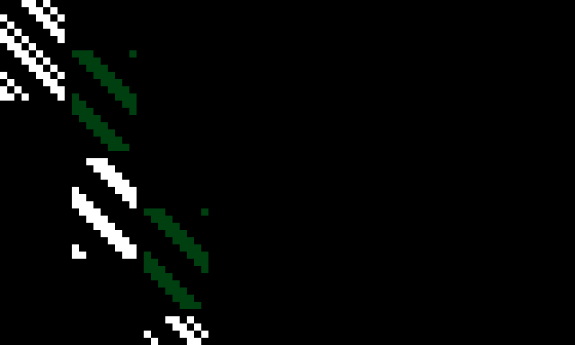 |  | 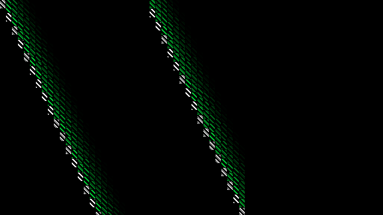 |

### Metaballs

**Scene:** [`examples/generators/metaballs.scene.json`](../examples/generators/metaballs.scene.json)

```json
{
  "count": 6,
  "threshold": 0.46,
  "speed": 1,
  "glow": 0.8,
  "palette": [[6, 255, 210], [0, 148, 255], [186, 48, 255], [255, 78, 152], [255, 242, 92]]
}
```

| ANSI (80×24) | ASCII (160×48 downscaled) | WebGL |
| :---: | :---: | :---: |
| 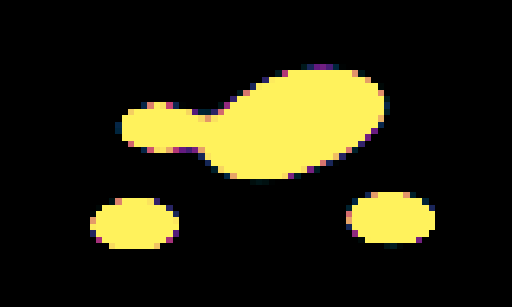 |  |  |

### Moiré

**Scene:** [`examples/generators/moire.scene.json`](../examples/generators/moire.scene.json)

```json
{
  "mode": "radial",
  "freq1": 14,
  "freq2": 15.5,
  "speed1": 0.5,
  "speed2": -0.35,
  "contrast": 1.5,
  "palette": [[0, 0, 0], [80, 20, 120], [255, 100, 200], [255, 255, 255]]
}
```

| ANSI (80×24) | ASCII (160×48 downscaled) | WebGL |
| :---: | :---: | :---: |
|  | 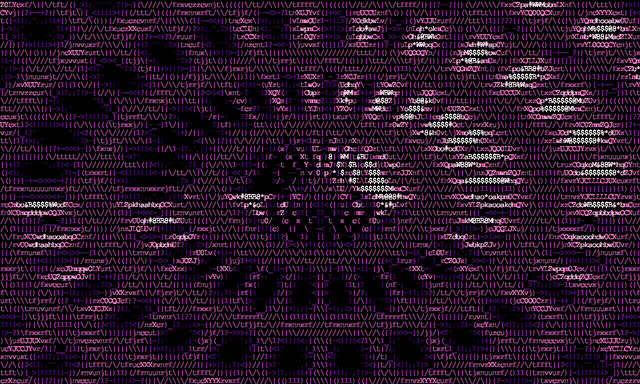 | 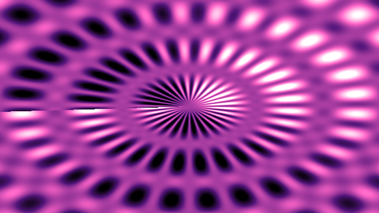 |

### Oscilloscope

**Scene:** [`examples/generators/oscilloscope.scene.json`](../examples/generators/oscilloscope.scene.json)

```json
{
  "color": "#5dffc8",
  "lineWidth": 2,
  "timeScale": 1.1,
  "voltScale": 1,
  "gridDivisions": 8
}
```

| ANSI (80×24) | ASCII (160×48 downscaled) | WebGL |
| :---: | :---: | :---: |
| 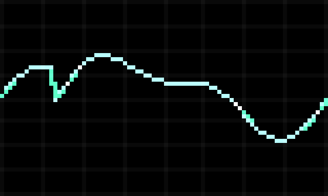 | 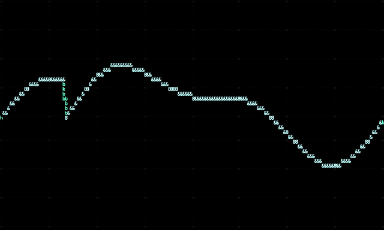 | 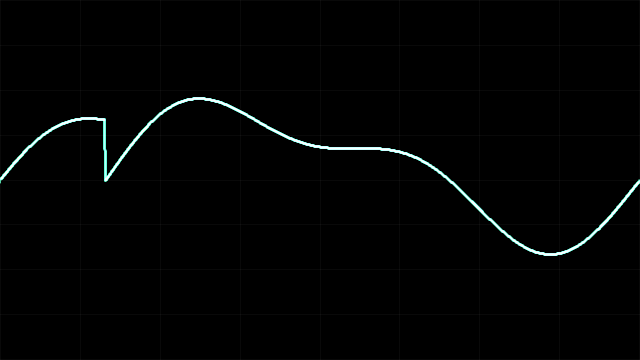 |

### Plasma

**Scene:** [`examples/generators/plasma.scene.json`](../examples/generators/plasma.scene.json)

```json
{
  "speed": 0.85,
  "scale": 1.7,
  "palette": [[14, 10, 42], [64, 28, 126], [0, 176, 255], [255, 104, 196], [255, 240, 116]]
}
```

| ANSI (80×24) | ASCII (160×48 downscaled) | WebGL |
| :---: | :---: | :---: |
| 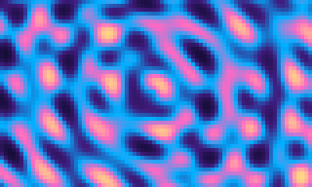 | 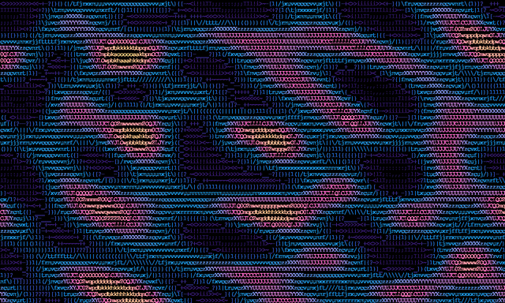 | 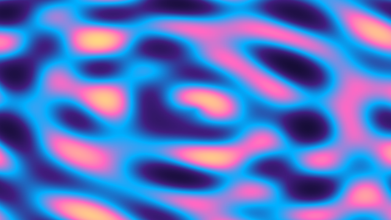 |

### Raymarcher (sphere)

**Scene:** [`examples/generators/raymarcher.scene.json`](../examples/generators/raymarcher.scene.json)

```json
{
  "fogColor": "#050a14",
  "cameraPos": [0, 0, 3],
  "scene": "return sdSphere(p, 0.85);"
}
```

| ANSI (80×24) | ASCII (160×48 downscaled) | WebGL |
| :---: | :---: | :---: |
| 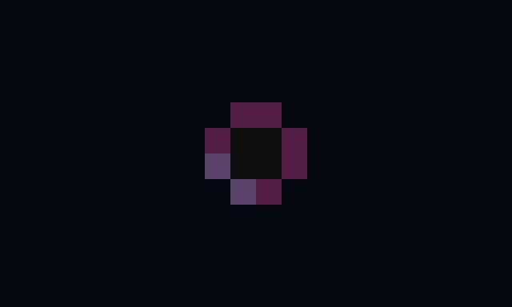 | 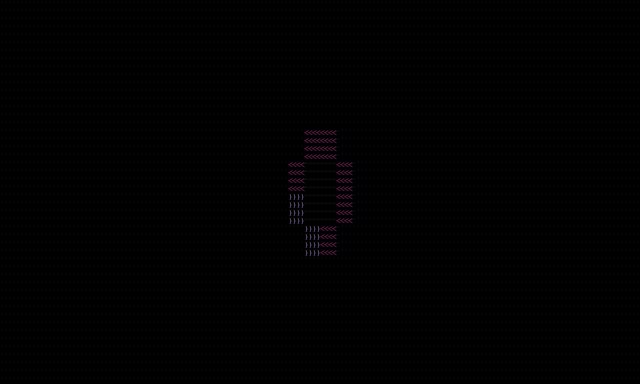 | 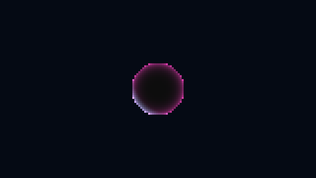 |

### Raymarcher Monument

**Scene:** [`examples/generators/raymarcher-monument.scene.json`](../examples/generators/raymarcher-monument.scene.json)

```json
{
  "fogColor": "#02050b",
  "cameraPos": [0, 0.25, 3.4],
  "scenePath": "../../shaders/raymarcher-monument.glsl"
}
```

| ANSI (80×24) | ASCII (160×48 downscaled) | WebGL |
| :---: | :---: | :---: |
| 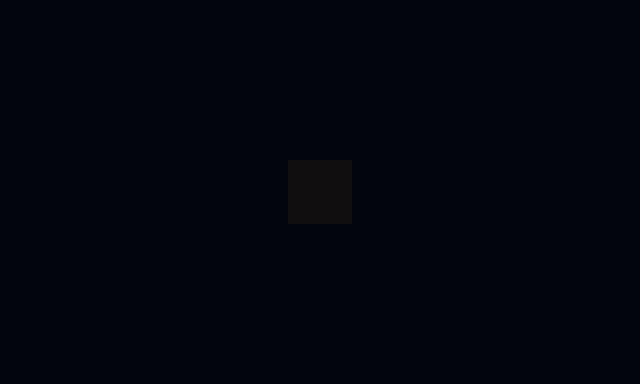 |  | 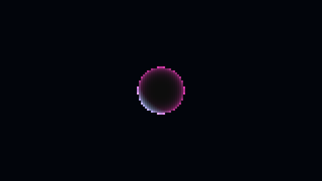 |

### Rotozoom

**Scene:** [`examples/generators/rotozoom.scene.json`](../examples/generators/rotozoom.scene.json)

```json
{ "rotationSpeed": 0.9, "zoomSpeed": 0.45, "zoomRange": [0.55, 1.85] }
```

| ANSI (80×24) | ASCII (160×48 downscaled) | WebGL |
| :---: | :---: | :---: |
| 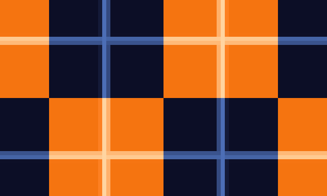 | 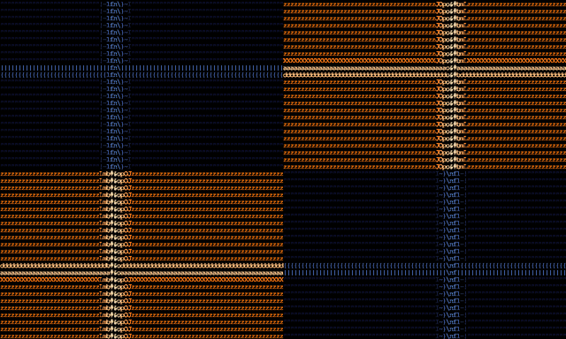 | 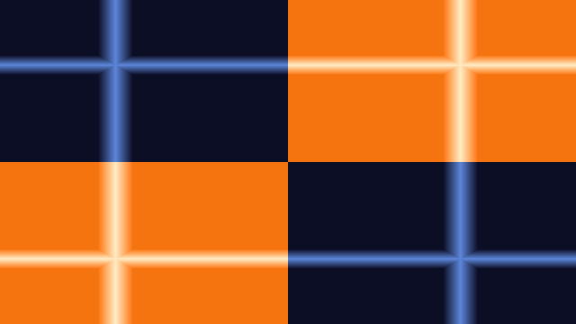 |

### Scroller

**Scene:** [`examples/generators/scroller.scene.json`](../examples/generators/scroller.scene.json)

```json
{
  "text": "  >>> OVERSCAN SCROLLER  >>>  ",
  "fontSize": 26,
  "speed": 32,
  "waveAmplitude": 4,
  "waveFrequency": 0.12
}
```

| ANSI (80×24) | ASCII (160×48 downscaled) | WebGL |
| :---: | :---: | :---: |
|  |  |  |

### Shadebobs

**Scene:** [`examples/generators/shadebobs.scene.json`](../examples/generators/shadebobs.scene.json)

```json
{
  "count": 9,
  "radius": 30,
  "speed": 1.2,
  "palette": [[24, 20, 56], [96, 46, 172], [255, 84, 180], [255, 226, 108]]
}
```

| ANSI (80×24) | ASCII (160×48 downscaled) | WebGL |
| :---: | :---: | :---: |
|  |  |  |

### Sinebobs

**Scene:** [`examples/generators/sinebobs.scene.json`](../examples/generators/sinebobs.scene.json)

```json
{ "count": 18, "radius": 22, "freqX": 1.1, "freqY": 1.35, "amplitude": 0.42 }
```

| ANSI (80×24) | ASCII (160×48 downscaled) | WebGL |
| :---: | :---: | :---: |
| 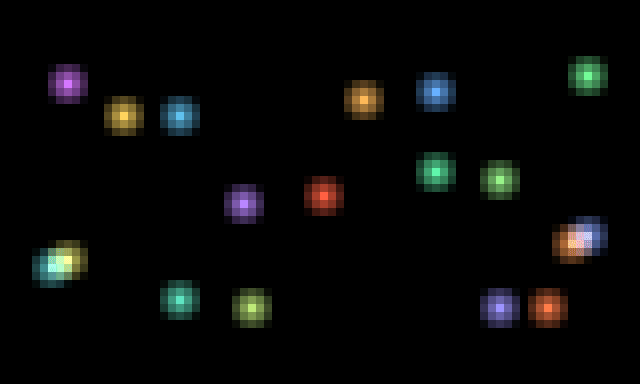 | 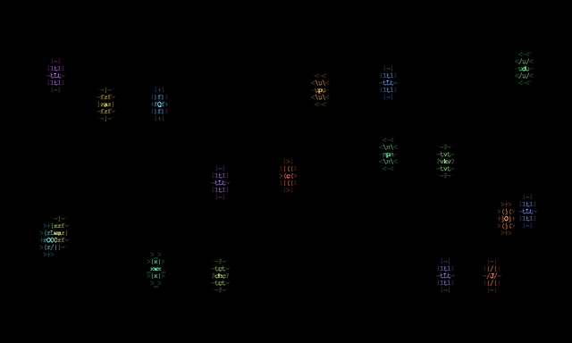 | 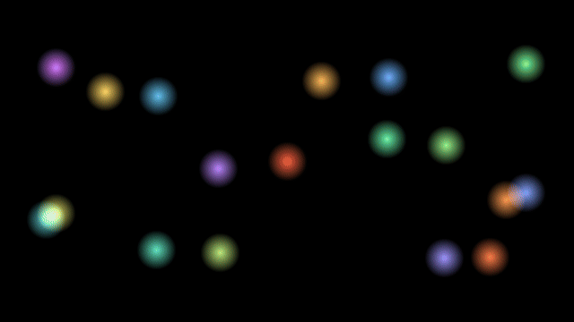 |

### Starfield

**Scene:** [`examples/generators/starfield.scene.json`](../examples/generators/starfield.scene.json)

```json
{ "count": 260, "warpSpeed": 1.15, "starColor": [230, 244, 255] }
```

| ANSI (80×24) | ASCII (160×48 downscaled) | WebGL |
| :---: | :---: | :---: |
| 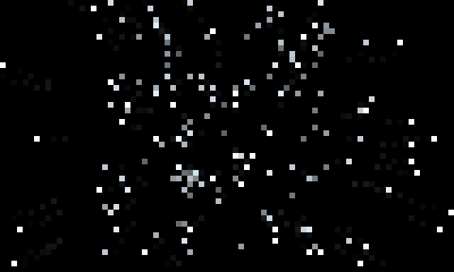 |  |  |

### Text

**Scene:** [`examples/generators/text.scene.json`](../examples/generators/text.scene.json)

```json
{
  "text": "OVERSCAN",
  "font": "overscan://fonts/Press2P",
  "fontSize": 42,
  "align": "center",
  "x": 0.5,
  "y": 0.5,
  "color": "#f4f7ff"
}
```

| ANSI (80×24) | ASCII (160×48 downscaled) | WebGL |
| :---: | :---: | :---: |
|  |  |  |

### Tunnel

**Scene:** [`examples/generators/tunnel.scene.json`](../examples/generators/tunnel.scene.json)

```json
{ "speed": 1.8, "twist": 0.12, "fog": 0.35, "zoom": 1.05 }
```

| ANSI (80×24) | ASCII (160×48 downscaled) | WebGL |
| :---: | :---: | :---: |
|  |  |  |

### Twister

**Scene:** [`examples/generators/twister.scene.json`](../examples/generators/twister.scene.json)

```json
{
  "twistSpeed": 1.8,
  "verticalFrequency": 1.45,
  "width": 0.28,
  "sway": 0.12,
  "shading": 0.82,
  "backgroundColor": "#050812",
  "palette": [[255, 78, 150], [255, 208, 72], [90, 246, 168], [82, 164, 255]]
}
```

| ANSI (80×24) | ASCII (160×48 downscaled) | WebGL |
| :---: | :---: | :---: |
|  |  |  |

### Vector Balls

**Scene:** [`examples/generators/vector-balls.scene.json`](../examples/generators/vector-balls.scene.json)

```json
{}
```

| ANSI (80×24) | ASCII (160×48 downscaled) | WebGL |
| :---: | :---: | :---: |
|  |  |  |

### Voxel Landscape

**Scene:** [`examples/generators/voxel-landscape.scene.json`](../examples/generators/voxel-landscape.scene.json)

```json
{}
```

| ANSI (80×24) | ASCII (160×48 downscaled) | WebGL |
| :---: | :---: | :---: |
|  |  |  |

### Water Ripple

**Scene:** [`examples/generators/water-ripple.scene.json`](../examples/generators/water-ripple.scene.json)

```json
{
  "damping": 0.99,
  "tapMode": "random",
  "tapRate": 2.2,
  "tapStrength": 0.85,
  "refraction": 0.38
}
```

| ANSI (80×24) | ASCII (160×48 downscaled) | WebGL |
| :---: | :---: | :---: |
|  |  |  |

### Wireframe

**Scene:** [`examples/generators/wireframe.scene.json`](../examples/generators/wireframe.scene.json)

```json
{
  "color": "#88f8ff",
  "backgroundColor": "#04070f",
  "lineWidth": 2.4,
  "scale": 1.1
}
```

| ANSI (80×24) | ASCII (160×48 downscaled) | WebGL |
| :---: | :---: | :---: |
|  |  |  |

---

## Advanced compositions

Pipeline summaries; full graphs are in each linked `*.scene.json`.

### Blur Glow Stack

Metaballs + text → screen-blend → blur-glow → glow → crt.

**Scene:** [`examples/advanced/blur-glow-stack.scene.json`](../examples/advanced/blur-glow-stack.scene.json)

| ANSI (80×24) | ASCII (160×48 downscaled) | WebGL |
| :---: | :---: | :---: |
|  |  |  |

### Cells Matrix Scope

Game of life + matrix rain (screen) + oscilloscope (additive) → color-grade → crt.

**Scene:** [`examples/advanced/cells-matrix-scope.scene.json`](../examples/advanced/cells-matrix-scope.scene.json)

| ANSI (80×24) | ASCII (160×48 downscaled) | WebGL |
| :---: | :---: | :---: |
|  |  |  |

### Copper Sinebobs

Copperbars + sinebobs → screen-blend.

**Scene:** [`examples/advanced/copper-sinebobs.scene.json`](../examples/advanced/copper-sinebobs.scene.json)

| ANSI (80×24) | ASCII (160×48 downscaled) | WebGL |
| :---: | :---: | :---: |
|  |  |  |

### Fire Scroller

Fire + scroller → additive-blend.

**Scene:** [`examples/advanced/fire-scroller.scene.json`](../examples/advanced/fire-scroller.scene.json)

| ANSI (80×24) | ASCII (160×48 downscaled) | WebGL |
| :---: | :---: | :---: |
|  |  |  |

### Floor Metaballs

Checkerboard floor + metaballs → screen-blend → glow → crt.

**Scene:** [`examples/advanced/floor-metaballs.scene.json`](../examples/advanced/floor-metaballs.scene.json)

| ANSI (80×24) | ASCII (160×48 downscaled) | WebGL |
| :---: | :---: | :---: |
|  |  |  |

### Fractal Floor

Fractal zoom + checkerboard floor → overlay-blend → lens → crt.

**Scene:** [`examples/advanced/fractal-floor.scene.json`](../examples/advanced/fractal-floor.scene.json)

| ANSI (80×24) | ASCII (160×48 downscaled) | WebGL |
| :---: | :---: | :---: |
|  |  |  |

### Moiré Mirror Cycle

Moire → mirror (octal) → palette-cycle.

**Scene:** [`examples/advanced/moire-mirror-cycle.scene.json`](../examples/advanced/moire-mirror-cycle.scene.json)

| ANSI (80×24) | ASCII (160×48 downscaled) | WebGL |
| :---: | :---: | :---: |
|  |  |  |

### Neon Layers

Plasma + tunnel (screen) + lasers (additive) → chromatic-aberration → glow → crt.

**Scene:** [`examples/advanced/neon-layers.scene.json`](../examples/advanced/neon-layers.scene.json)

| ANSI (80×24) | ASCII (160×48 downscaled) | WebGL |
| :---: | :---: | :---: |
|  |  |  |

### Raymarcher Metaballs

Raymarcher (GLSL file) + metaballs → screen-blend → color-grade.

**Scene:** [`examples/advanced/raymarcher-metaballs.scene.json`](../examples/advanced/raymarcher-metaballs.scene.json)

| ANSI (80×24) | ASCII (160×48 downscaled) | WebGL |
| :---: | :---: | :---: |
|  |  |  |

### Scroller ASCII

Starfield + scroller (`asciiFont`) → alpha-blend → palette-flash (track) → ansi-art.

**Scene:** [`examples/advanced/scroller-ascii.scene.json`](../examples/advanced/scroller-ascii.scene.json)

| ANSI (80×24) | ASCII (160×48 downscaled) | WebGL |
| :---: | :---: | :---: |
|  |  |  |

### Text Title

Plasma + text → screen-blend → feedback → glow → crt.

**Scene:** [`examples/advanced/text-title.scene.json`](../examples/advanced/text-title.scene.json)

| ANSI (80×24) | ASCII (160×48 downscaled) | WebGL |
| :---: | :---: | :---: |
|  |  |  |

### Transition Playground

Plasma ↔ lissajous via `transition` (`iris`, Rocket `transition.progress`).

**Scene:** [`examples/advanced/transition-playground.scene.json`](../examples/advanced/transition-playground.scene.json)

| ANSI (80×24) | ASCII (160×48 downscaled) | WebGL |
| :---: | :---: | :---: |
|  |  |  |

### Tunnel Roto Stack

Tunnel + rotozoom → overlay-blend.

**Scene:** [`examples/advanced/tunnel-roto-stack.scene.json`](../examples/advanced/tunnel-roto-stack.scene.json)

| ANSI (80×24) | ASCII (160×48 downscaled) | WebGL |
| :---: | :---: | :---: |
|  |  |  |

### Vector Balls Show

Starfield + vector-balls → screen-blend → glow → crt.

**Scene:** [`examples/advanced/vectorballs-show.scene.json`](../examples/advanced/vectorballs-show.scene.json)

| ANSI (80×24) | ASCII (160×48 downscaled) | WebGL |
| :---: | :---: | :---: |
|  |  |  |

### Voxel Cruise

Starfield + voxel-landscape → additive-blend → feedback → crt.

**Scene:** [`examples/advanced/voxel-cruise.scene.json`](../examples/advanced/voxel-cruise.scene.json)

| ANSI (80×24) | ASCII (160×48 downscaled) | WebGL |
| :---: | :---: | :---: |
|  |  |  |

### Water Dot

Water ripple + dot-matrix → screen-blend → mirror (quad) → crt.

**Scene:** [`examples/advanced/water-dot.scene.json`](../examples/advanced/water-dot.scene.json)

| ANSI (80×24) | ASCII (160×48 downscaled) | WebGL |
| :---: | :---: | :---: |
|  |  |  |

---

## See also

- [Graph model](graph-model.md)
- [Scene format](scene-format.md)
- [Terminal sink](terminal-sink.md)
- [`overscan-effects-catalogue.md`](../overscan-effects-catalogue.md)
